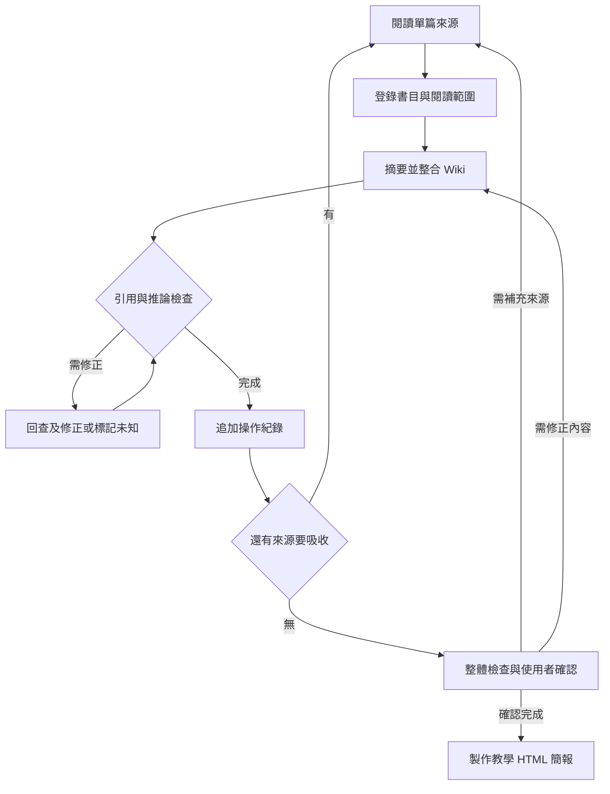

# LLM Wiki 工作流程

本專案已完成五篇資料吸收與八頁簡報。以下整理實際採用的流程，細節見 [操作日誌](wiki/log.md)。

## 流程文字版

1. 閱讀一篇來源，登錄書目與實際閱讀範圍。
2. 寫摘要，整合概念、主題與索引。
3. 檢查引用與推論。未通過時回查來源、修正內容，再檢查一次。這是內層修正循環。
4. 通過後追加日誌。仍有資料時回到第一步，直到完成五篇。這是外層吸收循環。
5. 整體檢查 Wiki，確認後製作簡報，再測試互動與來源連結。

分支的理由：避免未查證的主張一路進入簡報。循環的理由：每新增一篇資料都更新同一份知識庫，並且在當輪留下可追查的紀錄。

## 真實執行與流程調整

### 本輪執行

依序處理五篇來源，每輪更新書目、摘要、概念、主題與索引，回查原文並檢查相對連結後才追加日誌。逐輪結果見 [操作日誌](wiki/log.md)。

### 實際調整與驗證

首輪比對 2019 年 Results 表 1，發現主題草稿的「更快出現較低」可能被理解為每隻貓都跨過同一門檻。當輪把主題文字修成「有箱組的平均行為壓力評分下降較快」，並把量測定義和體重結果放在來源頁。此後逐篇查核都先定位原文的量測項目或段落，再確認主題文字適用的對象。第五輪實際以此方式核對 §2–4 和表 3，將錯覺方形與對照、實際方形與對照分開閱讀，並將平面研究定位為視覺案例。[第一篇來源](wiki/sources/s01.md) · [第五篇來源](wiki/sources/s05.md)

Wiki 階段最後集中整理主題頁的證據說明，並逐一解析 Markdown 相對路徑。當時尚未進行瀏覽器與圖片檢查，後續實測另見下節。研究統計未重算。

## 接手製作 HTML 簡報

接手後從既有 ZIP 解壓並閱讀 AGENTS.md、五篇來源摘要及主題綜合，再製作八頁教學簡報與可直接瀏覽的 Wiki。先前逐篇整理日誌保留原樣，不將先前回報冒充為本輪重新執行。

瀏覽器實測已確認封面示意圖顯示、按鈕翻頁、錯誤答案回饋、展開說明、方向鍵翻頁及簡報連到 S05 來源頁。程式檢視時發現原先方向鍵事件排除了按鈕焦點，已修正並實際從第五頁用方向鍵切換到第六頁。

這項經驗讓流程增加「以滑鼠點選後再用鍵盤操作」的檢查，因為分別測滑鼠與鍵盤不足以代表混用情境。研究統計重算、所有外部網址的可用性及手機實機測試未執行。列印按鈕已依使用者回饋移除。

## 四個反思問題

### 哪個節點最容易出錯？

內容上最需注意的是「把研究結果整理成大眾能懂的敘述」。本次曾修正群體平均結果的措辭，也反覆確認收容所、家貓及大型貓科的適用對象。沒有統計各節點的錯誤次數，因此不聲稱某節點在數量上出錯最多。

### 檢查應該往前移到哪裡？

在寫主題綜合與簡報文案前，先記錄研究對象、實際測量項目，以及來源是研究、指引或科普。這能避免把看似合理的解釋當成已證實的結論。設計階段則先確認讀者與風格，再選字型及照片，減少返工。

### 實際修改了什麼流程？

除了逐篇吸收後查核，也在改寫前先確認量測定義。簡報完成後增加混用滑鼠與鍵盤的測試。使用者確認方向後，再按回饋調整成真實貓咪照片與粉圓字型，不更動研究結論。

### 調整後如何驗證？

以第五篇研究確認平面輪廓與立體紙箱的問題不同。以瀏覽器確認按鈕取得焦點時右方向鍵可由第五頁進到第六頁；並確認猜題回饋、展開說明、圖片與來源頁連結。最終檔案與連結檢查結果保存在 [checks.json](checks.json)。
